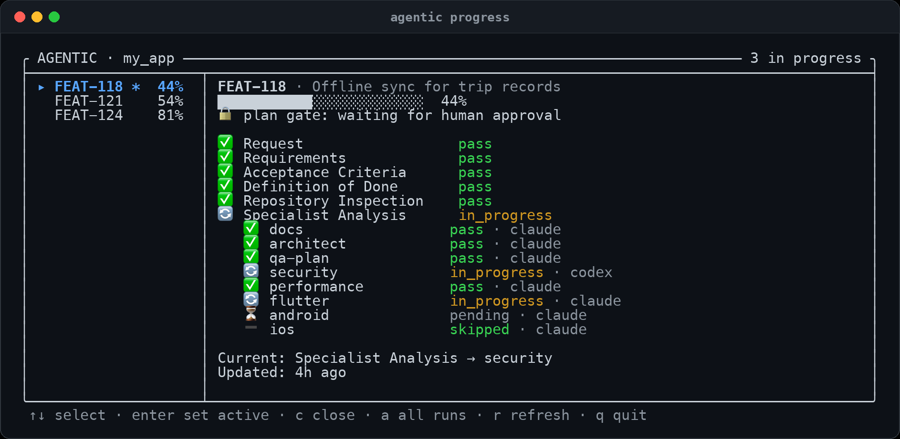
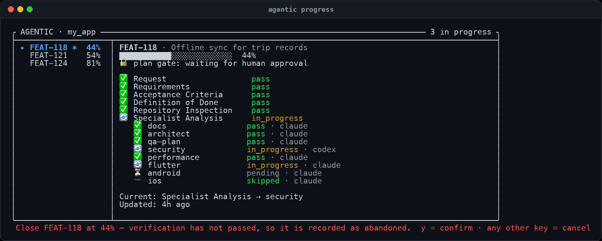

# Progress dashboard

Live terminal GUI for `/feature` runs, plus the commands for working with several features at once.

```bash
agentic progress              # dashboard, focused on the active feature
agentic dashboard             # same view, explicit command
agentic dashboard --all       # include finished runs
agentic runs                  # plain list of in-progress features
agentic runs --all --json     # every run, machine-readable
agentic switch FEAT-002       # make a feature the active run
```

## Layout

The left pane lists features, the right pane shows the highlighted run's stages and specialist roles. Both refresh every second.



```text
╭ AGENTIC · my-app ───────────────────────────────── 3 in progress ╮
├────────────────────┬─────────────────────────────────────────────┤
│ ▸ FEAT-002 *  43%  │ FEAT-002 · Payments retry on timeout        │
│   FEAT-007    12%  │ ██████████░░░░░░░░░░░░░░  43%               │
│   FEAT-011 ✓ 100%  │ 🔒 plan gate: waiting for human approval    │
│                    │ 🔄 Specialist Analysis      in_progress     │
│                    │    🔄 security             in_progress      │
│                    │ Current: Specialist Analysis → security     │
╰────────────────────┴─────────────────────────────────────────────╯
```

When the run's pull request is open (the `pull-request` stage, after final verification), the detail head shows `Pull request: #<number> <url>` under the plan gate line; the number comes first, so a narrow pane cuts the URL, not the number. When the stage was skipped or is blocked it shows `Pull request: not opened — run: agentic pr <id>` instead. `agentic progress <id>` and `agentic status <id>` print the same line right under the progress bar, and the Markdown view (`--markdown`, the GitHub progress comment) adds a **Pull request** line. A verified run with `pull_request` disabled in `.agentic/config.yaml` (or no block at all) and no `agentic pr` request reads as complete: the stage shows `skipped — pull_request disabled (open one with: agentic pr <id>)`, the run is 100% `Done`, and `R` refuses it (`✗ <id> is complete — press c to close it, or open its pull request: agentic pr <id>`).

| Marker | Meaning |
|---|---|
| `▸` | highlighted (what the right pane shows) |
| `*` | the active run — `agentic resume`, `approve`, `progress` default to it |
| `✓` | finished run (only visible with `--all` or `a`) |
| `⚠` | the run needs you: a stage blocked or failed, or a gate waits (see [Needs you](#needs-you)) |
| `●` | an engine is driving the run right now |

`⚠` and `●` come before the run id (`▸ ⚠ FEAT-011 *`), so a long id is cut, never the marker.

## Needs you

When the highlighted run waits on a human, a banner sits at the top of its detail pane. It gives the headline, the reason on one or two lines, the whole command to run next, and a `Commands:` block with everything that moves the run on:

```text
│ ⚠ NEEDS YOU · Final Verification (mobile-evidence) blocked     │
│   mobile-evidence: mobile evidence is required but no          │
│   Android/iOS target could be derived; use --platforms …       │
│ → agentic retry FEAT-011                                       │
│   Commands:                                                    │
│     retry                  agentic retry FEAT-011              │
│     retry mobile-evidence  agentic retry FEAT-011 mobile-evi…  │
│     status                 agentic status FEAT-011             │
│     doctor                 agentic doctor                      │
│     log                    .agentic-runs/FEAT-011/engine/bac…  │
│     artifact               .agentic-runs/FEAT-011/device/mob…  │
```

| The run | Headline | Command | Commands: |
|---|---|---|---|
| a stage failed or blocked | `<Stage> failed` / `<Stage> blocked` | `agentic retry <id>` (`agentic resume <id>` for the pull request, whose steps repeat safely) | `retry` (+ `retry <role>` per stopped role of a parallel stage), `why` when the agent's report was rejected, `status`, `doctor`, `log`, `artifact`, `rejected`, `notes` when `notes/<stage>.md` exists; the pull request adds `pr` |
| a stage's conditional role blocked (verification's `mobile-evidence`) | `<Stage> (<role>) blocked` | `agentic retry <id>` | `retry`, `retry mobile-evidence`, `status`, `doctor`, `log`, `artifact` (`device/mobile-device-qc.md`) |
| the same failure as last time | `Same failure as last time — this needs a fix outside <Stage>` | the same; retrying is allowed, but the cause is elsewhere | the same block |
| the plan waits for approval | `The plan waits for your approval` (then the plan digest) | `agentic approve <id>` | `approve`, `rework plan` (`agentic retry <id> plan`), `status`, `doctor`, `artifact` (`06-plan.md`) |
| architecture selection waits | `Architecture selection waits for you` | `agentic architecture <id> <option-id>` | `select`, `status`, `doctor`, the two `05-architecture-*.md` artifacts |
| specialist conflicts hold the plan back | `N conflicts need your decision` (reason: ids + topics, resolve + resume commands) | `agentic conflicts <id>` | `conflicts`, `resolve` (with the id when one is left), `resume`, `status`, `doctor`, `artifact` (`05-analysis/conflicts.json`) |
| verification passed, `pull_request` enabled, no pull request recorded | `Verified — no pull request recorded yet` | `agentic pr <id>` | `pr`, `status`, `doctor`, `log` |
| a stage is in progress but its engine is gone | `<Stage> is in progress but its engine (pid N) is gone` | `agentic retry <id>` (`resume` for the pull request) | `retry`, `status`, `doctor`, `log`, `owner` (`engine/engine.pid`) |

`status` and `doctor` are in every block; `log` appears whenever `<run>/engine/background.log` exists, `artifact` and `rejected` when the stopped stage's artifact or kept agent output (`engine/<stage>-<role>.rejected`) exists. On a terminal under 24 rows the block is left out so the stages stay visible. The last row is not a needs-you kind: a stage left `in_progress` by an engine that was killed keeps its `engine/engine.pid` record (a normal exit removes it), and when nothing alive holds that record the run is shown as stalled, with the same banner and block, in `agentic status <id>`, `runs.js status` and `agentic runs`. It raises no `⚠` list marker, bell or desktop notification, and a run driven by hand (no record) is never called stalled.

At the approval gate the banner also shows the plan digest between the reason and the command: `Plan: 9 steps · 23 acceptance criteria · 11 risks · REVIEW AMENDMENTS present`, up to six `│` lines of the plan summary (fewer on a short terminal; secrets redacted, printable text only, at most 600 characters), then `Full plan: <path> · P opens it · A approves`. Step, criterion and risk text is never shown. `P` opens the plan in `$PAGER` (default `less`, split on whitespace, no shell) with the dashboard suspended; when the pager cannot run, the path is shown instead.

While conflicts hold the plan back, CURRENT reads `Waiting for conflict decisions`; the engine waits there like a gate (exit 0), and `agentic resume <id>` runs the plan once every conflict is resolved. The furthest stopped stage wins. The text comes from the run state alone (`needsYou` and `recoveryCommands` in `ai/workflow/progress.js`), so the banner, `agentic status <id>`, `runs.js status`, `agentic runs`, the Markdown view, the engine's stop message and its desktop notification all say the same thing. The notification carries the block's short form after the reason, whole items only, with the command still last; the GitHub progress comment shows the headline and command, never the reason, the plan or the block, as it never publishes run notes or paths.

"Same failure as last time" appears when a stage, role or conditional role fails twice in a row with the same reason, ignoring timestamps, paths, attempt ids, hashes, pids and durations. The entry then has `repeatedFailure: <n>`. Reasons that say nothing about the cause (an agent exiting non-zero, a timeout, an interrupt, a bare exit status or signal) are never counted as repeats.

While the run's engine is running (`●`), the banner gives way to `● engine running · engine pid <pid> (<command>)`: the run is not waiting on you, even while its state still shows the block the engine is about to retry. `agentic status <id>`, `agentic progress <id> --watch` and the Markdown view say `● engine running` the same way.

Notes, role names and the fields of `engine.pid` are shown as printable text only: escape sequences and control characters become spaces, so text from agent or tool output cannot move the cursor, rewrite the command you are told to type, or write the clipboard.

## Notifications

The engine sends a desktop notification when a run needs you, completes, or (through `agentic pr`) opens its pull request. It sends it itself, so it arrives with this window closed. The dashboard does not send one. It rings the terminal bell and flashes `⚠ <id> needs you — …` in the hint line for each new event. When it opens it stays quiet about what was already waiting. Each event is shown once: its key is recorded in `state.notifications.sent`. A run that completes again after rework is a new event (the key carries the completion time). The notification's text is redacted before it is shortened (named token variables, any variable whose name ends in `TOKEN`, `SECRET`, `PASSWORD`, `_KEY` and similar, URL credentials and common token shapes), and the command it ends with is never cut. On macOS the command is also the subtitle.

On macOS, install `terminal-notifier` (`brew install terminal-notifier`) so that clicking a notification brings forward the app the engine runs in (Terminal, iTerm, VS Code…; `AGENTIC_NOTIFY_ACTIVATE=<bundle id>` picks another). Without it, notifications go through `osascript`, and clicking one opens Script Editor.

| `.agentic/config.yaml` | Default | Effect |
|---|---|---|
| `notifications.desktop` | `true` | `false` stops the engine's desktop notifications (macOS `osascript`, Linux `notify-send`) |
| `notifications.bell` | `true` | `false` stops the dashboard's terminal bell |

`off`/`no` and `on`/`yes` work as well as `false`/`true`. Any other value keeps the default; the engine prints the problem once and the dashboard shows it as a notice when it opens. Eval runs (`AI_EVAL=1`) never notify, and nothing is sent over the network.

## Keys

| Key | Action |
|---|---|
| `↑` `↓` / `k` `j` / `tab` | move between features (wraps) |
| `enter` / `space` | make the highlighted feature the active run |
| `R` | resume the highlighted feature in the background |
| `T` | retry its failed or blocked stages (and conditional roles), then resume in the background |
| `P` | open the highlighted feature's plan (`06-plan.md`) in `$PAGER` |
| `A` | approve the highlighted feature's plan (asks first), then resume in the background |
| `d` | switch the pane between the stages and what each running agent is doing (`esc` goes back) |
| `c` | close the highlighted feature (asks first) |
| `a` | toggle finished runs |
| `r` | refresh now |
| `home` / `end` | first / last feature |
| `q` / `esc` / `ctrl-c` | quit |

Five keys write. `enter` updates the `_active` pointer, `c` closes a run after you confirm, `A` approves a plan after you confirm, and `R`, `T` and `A` start the engine. Highlighting alone changes nothing. `A` approves only after you answer `y`; nothing approves on highlight or on a timer, and `A` on a run that is not at the gate says `✗ <id>: nothing waits for approval` and touches nothing.

## Why a stage stopped

When a stage fails because the agent's own report was rejected (its status was not `pass`), the banner reads that report (`<run>/engine/<stage>-<role>.rejected`) instead of the stored note, which is cut to 180 characters:

```
⚠ NEEDS YOU · Build + Tests failed
  All tests pass: 80/80 … flutter rewrote pubspec.lock and analysis_options.yaml …
  Tests: 80 passed, 0 failed, 0 skipped
  ✗ flutter analyze --no-pub <36 files> — fail: 4,464 issues …
  ! pubspec.lock changed by its tools
  · Revert what its tools changed (if still changed): git -C "<worktree>" checkout -- pubspec.lock analysis_options.yaml
  · Read the full report: agentic why <id>
  · Leave a note the retry will read (evidence, a decision): edit .agentic-runs/<id>/notes/build-test.md
→ agentic retry <id>
```

`agentic why <id>` prints the full story: the stored reason, what the agent said, test counts, failed checks, acceptance criteria it marked failed, files its tools changed (and whether the runtime restored them), what it did not run, and the numbered options. What you write in `<run>/notes/<stage>.md` is given to every role of that stage on its next attempt, and a retried role also sees its own rejected report.

Read-only roles no longer leave tool rewrites behind: the engine snapshots tracked files before such a role runs and restores whatever its tools changed (`ai/workflow/tracked-files.js`), so the revert option only appears for runs that stopped before 1.9.32.

## What each agent is doing

Every role line says what the role does, in one dimmed line under it: the role's `summary` in `ai/workflows/feature.yaml` when it has one, otherwise the first sentence of its `purpose`. Under a running role (or a running single-role stage such as Implementation) a second line says what it is doing now, and how long ago:

```
🔄 Specialist Analysis      in_progress
   ✅ docs                 pass · claude
      Resolve current, version-specific external library/framework documentation…
   🔄 security             in_progress · claude
      Threat-model auth, session, storage, PII, permissions, deep links, WebViews…
      ↳ Read lib/auth/session_store.dart · 4s ago
```

When the pane is short, the descriptions of finished roles go first, then the running roles' descriptions, then finished roles; what a running role is doing goes last. `agentic progress <id>` and `--watch` show the description and the current action for running roles too.

`d` turns the pane into the details view: one block per running agent, with its executor, how long it has run, what it does, and its last actions with their times, newest last. With nothing running it shows the agent that acted last. `agentic progress --details` opens on it.

```
● security · claude · 3m12s
  Threat-model auth, session, storage, PII, permissions, deep links, WebViews…
  12:01:03  Read lib/auth/session_store.dart
  12:01:05  $ grep -rn "refresh_token" lib/
  12:01:09  The refresh token is kept in SharedPreferences, not secure storage.
```

The same feed is on the command line, for one agent or every running one:

```bash
agentic activity <run-id>                    # every running agent, last 30 actions
agentic activity <run-id> security --follow  # one agent, live (ctrl-c stops)
agentic activity <run-id> implementation --lines 100 --json
```

Where it comes from: the engine runs each role with `router.js exec … --activity-file <run>/engine/<stage>-<role>.activity.jsonl`. The router then starts the agent with its streaming command (`stream_command` in `ai/agents.yaml`; for Claude, `--output-format stream-json --verbose`; Codex `--json` streams already) and, while it works, writes one line per action: a tool call and its target (`Read`, `Edit`, `Grep`, `Glob`, `Fetch`, `MCP <server>/<tool>`, a subagent), a command (`$ …`), or what the agent said. The artifact, cost and exit status are read from the same stream's final result, exactly as before. Tool results, file contents and the model's thinking are never written. Every line is redacted (the same rules as the notifications), stripped of control characters and cut to 240 characters before it is written. A file over 512 KB is moved to `.prev.jsonl` when the next attempt starts. Without `--activity-file` (evals, a hand-run `router.js exec`) the router runs the plain command as before. The published GitHub progress comment never carries activity.

## Resume, retry and approve from the dashboard

`R` runs `engine.js resume <id>` as a detached background process (no shell). `T` first runs `runs.js retry <id>`, the same reset as `agentic retry <id>`, then starts that resume. `A` asks `Approve <id>? The plan in <path> becomes binding and the engine resumes in the background.  y = confirm · any other key = cancel`, then runs `runs.js approve <id>` (whose own checks apply: the plan must have passed and analysis be done) and starts that resume; it is the same code path as `agentic approve <id>` (`ai/workflow/engine-launch.js`). The hint line says `resuming…` or `approving…` at once. Then it shows the engine pid and the log, `<run>/engine/background.log`, which collects every background engine's output, each start under a `=== <time> resume|retry|approve started from agentic progress ===` line. The `●` marker appears once the engine has claimed the run.

`R` refuses when the highlighted run's stage failed or blocked (other than the pull request, which a resume continues): `✗ <id>: <Stage> needs a retry first — press T (or run: <command>)`, since the engine leaves a stage whose attempts are spent as it is. On a gate it says `✗ <id> waits for you — run: <command>`, and on a complete run (verified, pull request skipped) `✗ <id> is complete — press c to close it, or open its pull request: agentic pr <id>` (the launcher's command line, `node ai/workflow/engine-launch.js resume <id>`, names the close command instead of the key). The footer and every notice are cut to the terminal width; below 127 columns the footer is a compact `↑↓ · ⏎ active · d details · R resume · T retry · A approve · P plan · …`, and below 107 columns `↑↓ · d details · R resume · T retry · A approve · P plan · c close · q quit`.

Both keys refuse while an engine for that run is alive. That covers one started from another terminal, as a running engine holds `<run>/engine/engine.pid`, and a running parallel-role pool. A record counts only while its pid is a live node process started when the record says; a pid reused by something else, or pid 1, does not hold the run. A closed run is refused too. When `T` finds nothing to retry, the hint line shows retry's own message, for example `nothing to retry; run agentic resume <id>`, and nothing starts.

## Closing a run

`c` asks before doing anything. Only `y` goes through; any other key cancels, and `ctrl-c` still quits.



```text
 Close FEAT-002 at 43% — verification has not passed, so it is recorded as
 abandoned.  y = confirm · any other key = cancel
```

What happens depends on the run:

| Run | Result |
|---|---|
| verification passed | closed normally, exactly like `runs.js close` |
| verification not passed | closed and recorded as **abandoned**: `state.json` gets `abandoned: true` and `closedReason`, and the run history gets an `abandon` entry with the reason |

Closing clears the `_active` pointer if it pointed at that run, and the feature leaves the in-progress list (still visible under `a` / `--all`, listed as `abandoned` rather than `done`).

Closing an unverified run is a human decision, so it needs admin mode, which the dashboard supplies only for a confirmed keypress on a real terminal. Agents cannot reach it: without a TTY the dashboard prints one frame and exits, and `runs.js close` still refuses an unverified run unless `AI_WORKFLOW_ADMIN=1`. There is no CLI flag that bypasses the verification gate.

There is no reopen: closing is recorded in the run history and a closed run stays closed.

## Which run opens

1. an explicit `--run <id>`;
2. otherwise the active run;
3. otherwise the most recently updated in-progress feature.

In-progress features sort first, most recently updated first. A run counts as in progress until it is closed (`state.json` `status: done`).

## Detail compaction

The PR line, when there is one, takes one row of the head, and the needs-you banner takes up to seven (more with the plan digest and the `Commands:` block, which give way first on a short terminal), so they cost rows of stages. The right pane fits whatever the terminal gives it, dropping the least useful information first: all stages with all roles → roles only for running or stuck stages → those stages alone → stages that have started. A terminal narrower than 78 columns stacks the list above the detail instead of splitting.

## Non-interactive use

Without a TTY — piped, redirected, or in CI — the dashboard prints one frame and exits, so `agentic progress | less` and log capture behave. Scripts should prefer:

```bash
agentic runs --json           # every run with percent, current stage, active flag
agentic progress <id> --json  # one run in detail
```

`--demo` renders sample features without touching the state directory, for a screenshot or a quick look at the layout.

## Where state comes from

Runs live in the state root: `.agentic-runs/` in a target project, `ai/runs/` inside the runtime repository. Each run directory holds `state.json` (stages, roles, evidence, `notifications.sent`, and `pullRequest` once the PR is open: only its provider, number, URL, status, branch, base and draft flag are shown), `engine/engine.pid` while an engine drives it, optional `00-request.md` (the title shown next to the id) and `plan.approved` (the plan gate). The dashboard only reads these, apart from the `_active` pointer, `c`, and the engine `R`/`T` start; the workflow engine owns them.
